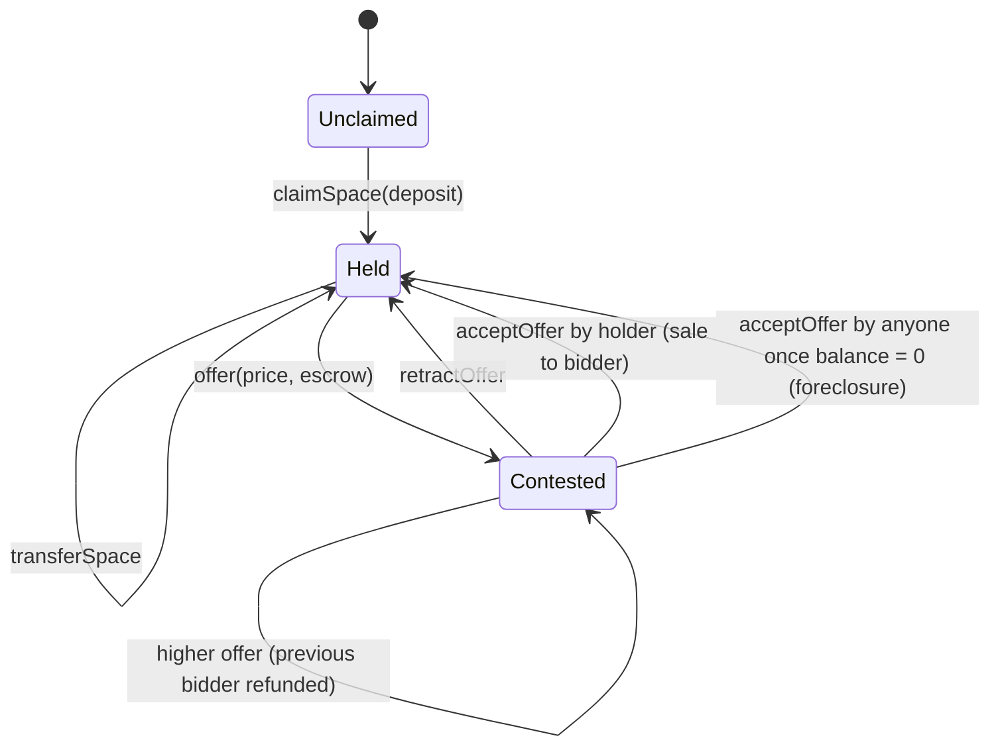

# Space Marketplace

**Harberger-style, continuously streamed subscription memberships for DAOs.**

DAO memberships are usually a one-off NFT or token purchase, so holders have no ongoing skin in the game and idle seats never come back on the market. Space Marketplace replaces them with **100 "spaces" that holders rent** at a price the market sets:

- Holders **pre-fund a WETH balance** that streams to the DAO treasury every second.
- The stream rate is **10% per year of the highest standing offer** on the space. The more someone else wants your seat, the more it costs you to keep it.
- Anyone can **bid** and escrow both their price and their own prepaid balance.
- The holder can **sell to the top bidder** at any time. Once the holder's balance runs dry, **anyone can force the sale** (foreclosure).

Holders can put a space to use by displaying an NFT they own (`setSpaceUri`).

> **Credits.** The original (v1) contract was written by the Space Marketplace team; I built the dApp around it in 2023 (Next.js 13 App Router, thirdweb, Tailwind). In 2026 I audited the contract, found **five accounting bugs, two of them fund-loss**, and rewrote it as v2 with a Foundry test suite. The v1 source is preserved in [`contracts/legacy/`](contracts/legacy/SpaceMarketplaceV1.sol), and each bug has a regression test that runs the same scenario against v1 and v2.

---

## Mechanism



### Streaming math

Each space stores its balance **as of the last settlement** and a per-second burn rate:

```
subscBurn  = highestOffer × 10% / 365 days          (wei / second)
due(t)     = min(balance, subscBurn × (t − subscTime))
remaining  = balance − due(t)
```

Every state-changing call follows the same three steps:

1. **`_settle`**: move `due` from the space's balance to `receiverBal` and set `subscTime = now`.
2. **Mutate**: deposit, withdraw, change the offer or owner.
3. **`_reprice`**: recompute `subscBurn` from the new top offer.

Keeping that order is what makes lazy accrual exact. Every v1 bug below came from breaking it.

### Invariants (enforced by the fuzzer)

| Invariant | Meaning |
|---|---|
| **Solvency** | `WETH.balanceOf(market) == Σ balance + Σ (highestOffer + subscOffer) + receiverBal`: every wei is owed to exactly one holder, bidder, or the treasury |
| **Stream conservation** | `Σ getRemainingBalance + getSubscriptionRevenue == Σ balance + receiverBal`: settling on read loses nothing |
| **No self-bids** | A space's owner is never its top bidder |

---

## v1 → v2: bugs found and fixed

| # | Bug in v1 | Impact | Fix in v2 | Regression test |
|---|---|---|---|---|
| 1 | `offer()` overwrote `highestOfferer` **before** sending the refund to it | 🔴 Outbid bidder's escrow was paid to the new bidder, who bid for free | Cache the previous bidder; refund after updating state | `test_bug1_outbidEscrowPaidToNewBidder` |
| 2 | `claimRevenue()` never reset `receiverBal` | 🔴 Admin could call it repeatedly and drain holders' balances and bidders' escrow | Zero `receiverBal` before transferring | `test_bug2_revenueClaimableRepeatedly` |
| 3 | `deposit()` added funds **before** settling the stream | 🟠 Topping up a depleted space sent the entire top-up to the treasury | Settle, then credit | `test_bug3_topUpOfDepletedSpaceIsLost` |
| 4 | `withdraw()` re-settled without advancing `subscTime` | 🟠 Elapsed stream charged twice, with the excess stranded in the contract | Single `_settle` before mutating | `test_bug4_withdrawDoubleCharges` |
| 5 | `acceptOffer()` refunded the stale, unsettled balance, pulled the buyer's deposit from the **seller**, and kept the old burn rate | 🟠 Seller charged the buyer's deposit, buyer's balance kept burning, books didn't balance | Settle first; the bidder's escrow becomes the new balance; reprice | `test_bug5_acceptOfferMisaccounts` |

Also hardened:
- All token transfers use `SafeERC20` (v1 ignored `transfer` return values).
- `nonReentrant` on every function that moves funds.
- Custom errors and events for every state change.
- OpenZeppelin `Ownable`; zero-address checks.
- Transferring a space to its current top bidder refunds their open offer.

The external ABI is unchanged (`spaces(uint256)` keeps its field order), so the existing frontend works against v2.

---

## Tests

```
forge test
```

| Suite | What it covers |
|---|---|
| `SpaceMarketplace.t.sol` | 25 unit tests plus 3 fuzz tests (1,000 runs each): stream rate, caps, deposits and withdrawals, bidding, foreclosure, transfers, revenue, metadata |
| `V1Regressions.t.sol` | 5 tests, each reproducing a v1 bug and asserting v2's correct behaviour on the identical scenario |
| `SpaceMarketplace.invariant.t.sol` | Handler-based invariant fuzzing: 256 runs × 64 calls across claim, deposit, withdraw, offer, retract, accept, transfer, claim revenue and time warps, with **0 reverts** |

**Coverage** (`forge coverage --ir-minimum`, `SpaceMarketplace.sol`): **98.6% lines · 97.5% statements · 91.3% branches · 100% functions**

CI runs `forge fmt --check`, build and the full test suite, plus Slither on every push.

---

## Repository layout

```
contracts/
  SpaceMarketplace.sol          v2 contract
  legacy/SpaceMarketplaceV1.sol original contract (reference only)
test/                           unit, fuzz, regression and invariant suites
script/Deploy.s.sol             WETH=<addr> forge script ... --broadcast
app/, components/               Next.js 13 dApp (thirdweb)
```

## Running

**Contracts**

```bash
git clone --recurse-submodules https://github.com/yasinadil/space-marketplace
cd space-marketplace
forge test
```

**dApp**

```bash
npm install
npm run dev
```

The dApp was built against a v1 deployment on Polygon Mumbai, which has since been shut down. To run it end-to-end, deploy v2 with `script/Deploy.s.sol` to any EVM testnet, then update the addresses in `components/Config/Config.ts` and `activeChain` in `app/ThirdWeb/thirdwebprovider.tsx`.

## Stack

Solidity 0.8.24 · Foundry (unit, fuzz, invariant) · OpenZeppelin 5 · Slither · Next.js 13 · thirdweb · Tailwind CSS
